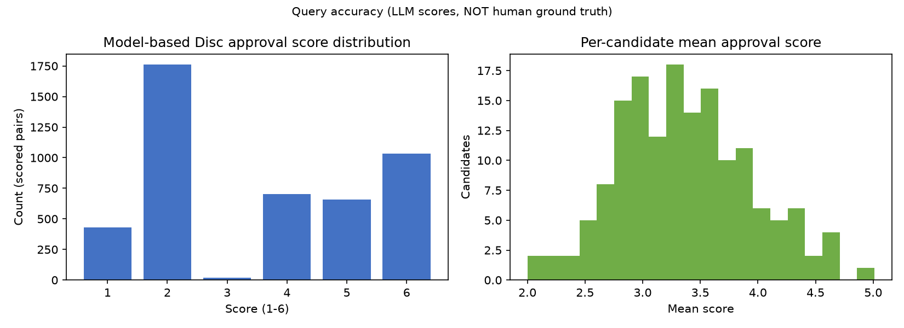
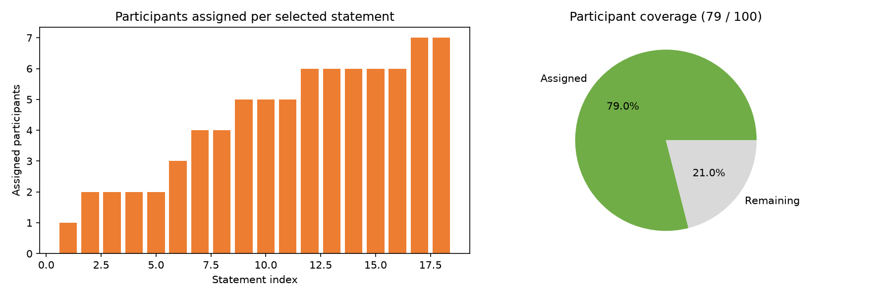
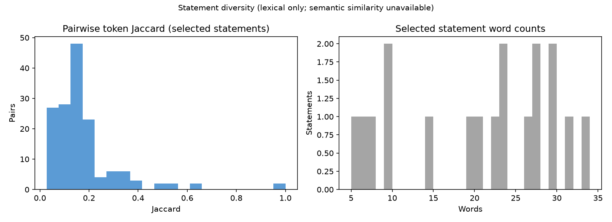
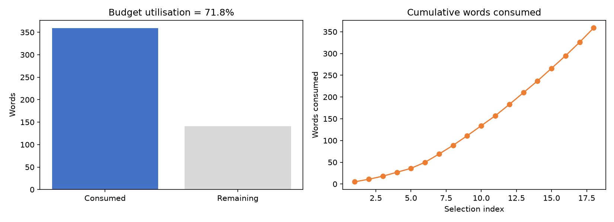
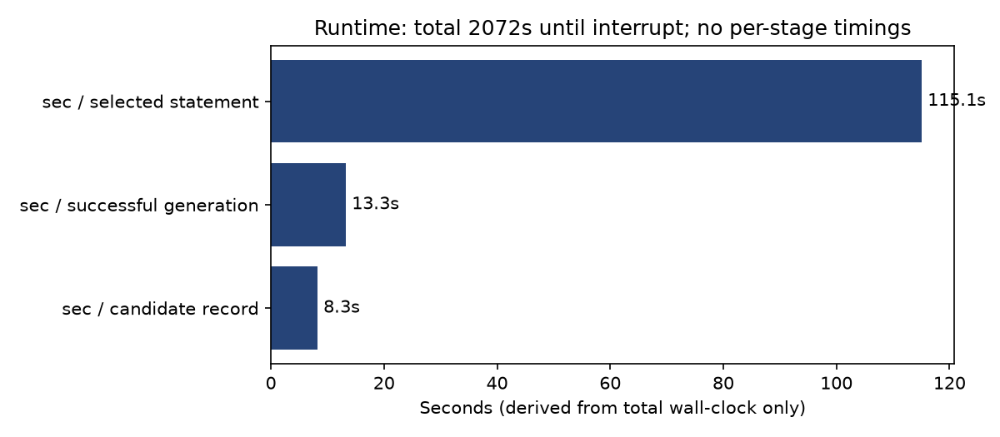

# Evaluation of the Partial Next-Gen GSC (PROSE) Run — Abortion Dataset

**Scope.** This section evaluates the *partial, interrupted* 500-budget Algorithm 1 run stored in
`calibration/cost_constrained_experiment_500_final/budget_500.checkpoint.json`. All figures are
computed from that checkpoint plus its `manifest.json`. No experiment was rerun, no Ollama calls
were made, no new candidates were generated, and no original experiment file was modified.

## Methodology

The checkpoint is a v2 Algorithm 1 snapshot containing 18 selected statements, 251 candidate
records (156 successful generations, 95 generation failures), 79 assigned participant IDs, 21
remaining IDs, a 4,469-entry approval score cache, and the loop cursor. The run manifest records
the model (`qwen3:8b`), endpoint, seed (0), participant count (100), interrupted status, and
wall-clock runtime.

An evaluation script (`calibration/evaluate_500_partial.py`) reads these two files and writes all
artifacts to a **new** directory `calibration/evaluation_500_partial/`. Extracted records are
exported as CSV (selected statements, candidate records, approval scores, generation failures,
score cache); metric outputs are exported as per-measure JSON/CSV; five charts and this report
are generated alongside a combined `evaluation_summary.json`. Word counts use
`PROSE.utils.helper_functions.count_words` (whitespace split) so budget checks match the
algorithm's own accounting.

## Results

### Data extracted

| Item | Count |
|---|---:|
| Candidate records | 251 |
| Successful generations | 156 |
| Generation failures | 95 |
| Selected statements | 18 |
| Assigned participants | 79 |
| Remaining participants | 21 |
| Cached approval scores | 4,469 |

### 1. Query accuracy — **model-based scores, not human-ground-truth accuracy**

The discriminative query produced **4,603 participant–statement approval scores**, all integers in
the expected 1–6 range (0 out of range). Distribution:

| Score | 1 | 2 | 3 | 4 | 5 | 6 |
|---|---:|---:|---:|---:|---:|---:|
| Count | 430 | 1,761 | 18 | 703 | 656 | 1,035 |
| % | 9.34 | 38.26 | 0.39 | 15.27 | 14.25 | 22.49 |

Mean **3.54**, median **4**, standard deviation **1.79**. The distribution is strongly bimodal —
scores 2 and 6 account for ~61% of all scores while score 3 is almost absent (0.4%) — which is a
property of the LLM scorer's prompt/behaviour, not a validated property of participants' views.

Per-candidate mean scores average 3.37 (sd 0.57, range 2.0–5.01); the modal score accounts for
49.7% of a candidate's scores on average. Mean supporter fraction at the active threshold is
16.2%. Two statements were scored more than once; all 4,603 cached score values match the scores
recorded in candidate records (0 conflicts). **This consistency is guaranteed by the score cache
and is not an independent test–retest reliability result.** No human ratings exist in this
project, so accuracy relative to ground truth, calibration, or any cBJR guarantee cannot be
claimed.

### 2. Representation

All **18 selected statements** assigned exactly their Algorithm 1 `required_support` participants
(never all threshold supporters), summing to **79 distinct participants = 79.0% coverage**;
21 participants (21.0%) remain unrepresented. Assigned participants per statement: mean 4.39,
median 5, range 1–7 (distribution: 1→1 statement, 2→4, 3→1, 4→2, 5→3, 6→5, 7→2). Threshold
supporter counts were much larger (8–70 per statement), so statements represent only a small
fraction of the agents who approved them.

### 3. Statement diversity

The 18 selected statements contain **16 unique texts — two exact duplicates** (selections 4 & 5:
"Abortion is a personal right, not a political issue."; selections 15 & 16: a rape/health-risk
qualification statement). Across all 156 successful generations, 154 are unique (2 duplicates).
Mean pairwise token Jaccard among selected statements is **0.177** (median 0.14; content-word
Jaccard 0.140 / median 0.10), indicating mostly low lexical overlap, with a maximum of 1.0 driven
by the two duplicate pairs. Vocabulary: 133 distinct tokens over 363 tokens (type–token ratio
0.366). Statement length: mean 19.9 words, median 22.5, range 5–33.

**Semantic similarity was not computed.** No statement embeddings exist in the project; the only
available embeddings are participant embeddings (`qwen3:0.6b`) built from participant summaries,
which are not comparable to statements. Computing statement embeddings would require Ollama
calls, which are explicitly out of scope for this evaluation. Only lexical measures are reported.

### 4. Budget utilisation

Sum of selected statement word counts = **359**, exactly matching the checkpoint's implied
consumption (500 − 141 = 141 remaining), the last selection's cumulative `budget_consumed`, and
`count_words` on every selected statement. Utilisation = **359 / 500 = 71.8%**; **141 words
(28.2%) remain unspent** because the run ended with termination reason `thresholds_exhausted`
(interrupted before all utility levels/costs were explored), not because the budget was exhausted.

### 5. Runtime

The manifest records **2,071.93 s (34.53 min)** of wall-clock runtime before the
`KeyboardInterrupt`. This is the *total* for the partial run. The checkpoint contains **no
per-generation or per-scoring timestamps**, so separate average generation/scoring times cannot be
calculated. For orientation only, dividing total runtime by event counts gives 8.26 s per
candidate record, 13.28 s per successful generation, and 115.11 s per selected statement; these
are aggregate derived figures that include retries, scoring, connectivity checks and interrupt
handling — **not measured per-stage timings**.

## Validation

All 16 reconciliation checks pass (`validation_checks.csv`), including: no duplicate participant
assignments (within or across statements); 79 assigned + 21 remaining = 100 and the union is
exactly `generation1`–`generation100`; per-statement assignment counts sum to 79; budget
consumed = 359 and remaining = 141 (sum 500); selected count = 18; candidate record count = 251
= cursor candidate number; all scores in 1–6; score cache matches recorded scores; and every
selected statement has a matching successful generation record.

## Interpretation and limitations

- The run is **partial** (71.8% budget use, 21% of participants unrepresented); these results
  describe a truncated process, not a completed PROSE slate.
- "Accuracy" here is descriptive of the LLM scorer's score distribution and internal consistency;
  it is **not** human-ground-truth accuracy. Score 3 is nearly unused, suggesting the scorer's
  scale is being applied coarsely.
- Representation is proportional in the limited sense that each statement covers only its
  required number of highest-utility supporters; no BJR/cBJR claim follows from this partial run.
- Statement diversity is moderate with two duplicated selected statements; semantic diversity is
  unmeasured because no statement embeddings and no embedding calls were available.
- Runtime is a single aggregate figure with no stage-level breakdown; per-call timings are absent
  from the checkpoint and were not estimated beyond the clearly labelled divisions above.
- Scope is intentionally appropriate for an MSc project: descriptive measurement and internal
  reconciliation only, with no theoretical or publication-grade claims.
